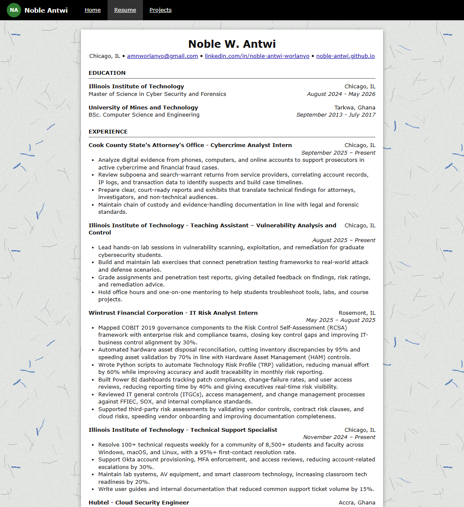
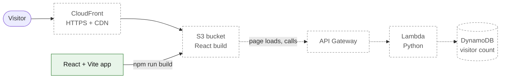

# Cloud Resume Challenge

My resume as a cloud-hosted website, built step by step for the [Cloud Resume Challenge](https://cloudresumechallenge.dev/docs/the-challenge/aws/) on AWS. The challenge covers what a cloud engineer does day to day: a static frontend, a serverless API, a database, infrastructure as code, and CI/CD.

> **Status: in progress.** The React frontend is complete and runs locally. AWS hosting, the visitor counter API, infrastructure as code, and CI/CD are the next stages. See [Roadmap](#roadmap).



## What is built today

- **Home, Resume, and Projects pages**, with client-side routing.
- **A detail page for every project** (`/projects/<name>`), opened from a "View Project Details" button, with a link to the source on GitHub.
- **The resume itself:** styled as a printed page, one shared layout for every entry, and readable on phones and in print.
- **Content kept apart from code:** everything the site says lives in two data files, so updating the resume never touches layout code.
- **A clean build:** lint and production build both pass, and dependencies are pinned with a lockfile.

## Architecture

Solid boxes are built. Dashed boxes are planned.



All AWS resources will be defined as code and deployed by GitHub Actions on every push to `main`.

## Roadmap

Progress against the 16 steps of the challenge.

| # | Step | Status |
|---|------|--------|
| 1 | Certification | Done: AWS Solutions Architect Associate, SysOps Administrator, Security Specialty |
| 2 | Resume written in HTML | Done (React components) |
| 3 | Styled with CSS | Done |
| 4 | Static website on S3 | Next |
| 5 | HTTPS with CloudFront | Planned |
| 6 | Custom domain (Route 53) | Planned |
| 7 | JavaScript visitor counter | Planned |
| 8 | DynamoDB table for the count | Planned |
| 9 | API Gateway + Lambda | Planned |
| 10 | Lambda written in Python | Planned |
| 11 | Tests for the Lambda | Planned |
| 12 | Infrastructure as code | Planned |
| 13 | Source control | Done (this repo) |
| 14 | CI/CD for the backend | Planned |
| 15 | CI/CD for the frontend | Planned |
| 16 | Blog post about the build | Planned |

## Tech Stack

| Layer | Built with | Status |
|-------|-----------|--------|
| Frontend | React 19, Vite 5, React Router 7, plain CSS | Done (project screenshots still placeholders) |
| Hosting | Amazon S3, CloudFront, Route 53, ACM | Planned |
| API | API Gateway, AWS Lambda (Python) | Planned |
| Database | Amazon DynamoDB | Planned |
| Infrastructure | Infrastructure as code (tool chosen at that stage) | Planned |
| CI/CD | GitHub Actions | Planned |

## Repository Layout

```
cloud-resume-challenge/
├── frontend/           React + Vite website (see frontend/README.md)
│   ├── public/         favicon and background texture
│   └── src/
│       ├── pages/      Home, Resume, Projects, Project detail, Not Found
│       ├── components/ layout/, resume/, projects/
│       ├── data/       resume and project content
│       └── assets/stylesheets/
└── docs/
    ├── images/         screenshots for this README
    └── reference/      IIT resume format used as the content guide
```

Backend and infrastructure folders will be added when those stages start.

## Run It Locally

Requires Node.js 18 or newer.

```bash
cd frontend
npm ci          # install the exact locked versions
npm run dev     # http://localhost:5173
```

Other commands: `npm run lint` (code checks) and `npm run build` (production build into `frontend/dist/`).

## Author

**Noble W. Antwi**, cloud security and identity and access management.

- LinkedIn: [noble-antwi-worlanyo](https://linkedin.com/in/noble-antwi-worlanyo)
- GitHub: [noble-antwi](https://github.com/noble-antwi)
- Portfolio: [noble-antwi.github.io](https://noble-antwi.github.io/)

Built for the Cloud Resume Challenge created by Forrest Brazeal. The resume layout follows Andrew Brown's course build.
